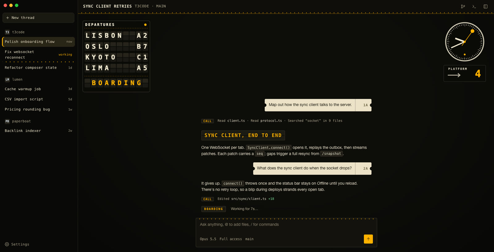

# Departures

A dark theme for T3 Code in black, cream and amber, styled as a split-flap departures board. Flaps rattle when the agent starts working. When it stops, the board clatters back to on time.

[Live site and demo](https://joshsaintjacque.github.io/t3code-theme-departures/)



## Install

1. Open `departures.json` and copy it (or use **Copy theme JSON** on the [site](https://joshsaintjacque.github.io/t3code-theme-departures/)).
2. In T3 Code, go to Settings > Appearance > Add theme, paste, and save.
3. Or from a terminal:

```sh
curl -fsSL -o departures.json https://joshsaintjacque.github.io/t3code-theme-departures/departures.json
~/.t3/bin/t3 theme set departures.json
```

## What moves

| State | Motion |
|---|---|
| At rest | Gutter board reads ON TIME; a station clock hand ticks every 3 seconds; every 45 seconds one destination row flips to a new city |
| Turn starts | Board rows rattle hard for about 5 seconds, settling into BOARDING; the departure lamp lights |
| Turn running | Board holds BOARDING and refreshes one row every 18 seconds; amber runway lights run along the header and composer edge; the Working row is a flap tile that rattles BOARDING once |
| Background thread busy | The thread row gets a slow chase line |
| Turn complete | The board clatters back to ON TIME, the lamp flashes and the header rule fades from amber, only when a turn ends |
| Hover and focus | Amber platform rail beside hovered rows; composer edge turns amber on focus |
| Window under 1440px | The board shrinks to about 140px at 1440px; below that a one-row ON TIME / BOARDING tile takes its place in the right gutter |
| Reduced motion | Everything freezes: ON TIME at rest, BOARDING while working |

## Palette

| Role | Hex |
|---|---|
| `canvas` | `#0d0c0a` |
| `sidebar` | `#0a0908` |
| `surface` | `#17150f` |
| `text` | `#f2e9d2` |
| `textMuted` | `#b8ad93` |
| `accent` | `#ffb000` |
| `accentForeground` | `#17110a` |
| `messageSurface` | `#ece2c8` |
| `messageForeground` | `#1b1710` |
| `border` | `#34302a` |
| `codeBackground` | `#14120e` |
| `sidebarRowSelected` | `#2a2518` |
| `warningForeground` | `#ffd27a` |
| `update` | `#9fdca0` |
| `error` | `#ff7a66` |

All roles are in `departures.json`. The theme uses system fonts only (Helvetica and the system monospace).

## Build

`python3 source/build.py` regenerates `departures.json`; `python3 source/make_site.py` regenerates `index.html`.

Not affiliated with T3. MIT licensed.
